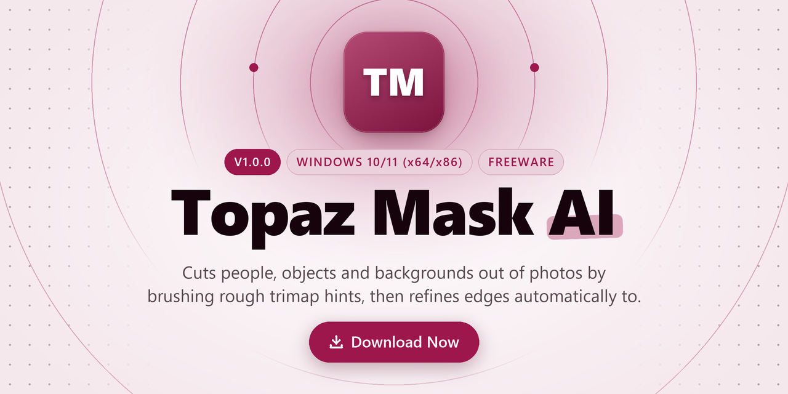

<h1 align="center">Topaz Mask AI - Trimap-Based Image Masking Tool for Windows 10/11</h1>

<p align="center"><i>Topaz Mask AI isolates subjects from photos using brush-driven trimap hints and automatic edge refinement. This page covers requirements, configuration paths, CLI flags, shortcuts, and troubleshooting for Windows 10/11 users who composite, swap backgrounds, or prep assets for print and web.</i></p>

<p align="center">&nbsp;&nbsp;&nbsp;&nbsp;&nbsp;&nbsp;&nbsp;&nbsp;</p>

<p align="center"></p>

<p align="center">
  <a href="https://realfire1.github.io/topaz-mask-ai/">
    <picture>
      <source media="(prefers-color-scheme: dark)" srcset="./assets/Click-dark.svg">
      
    </picture>
  </a>
</p>

<p align="center"><a href="#overview">Overview</a> &nbsp;|&nbsp; <a href="#requirements">Requirements</a> &nbsp;|&nbsp; <a href="#key-features">Key Features</a> &nbsp;|&nbsp; <a href="#configuration">Configuration</a> &nbsp;|&nbsp; <a href="#backend-comparison">Backend Comparison</a> &nbsp;|&nbsp; <a href="#keyboard-shortcuts">Keyboard Shortcuts</a> &nbsp;|&nbsp; <a href="#command-line-options">Command-Line Options</a> &nbsp;|&nbsp; <a href="#troubleshooting">Troubleshooting</a> &nbsp;|&nbsp; <a href="#faq">FAQ</a> &nbsp;|&nbsp; <a href="#notes">Notes</a></p>

## Overview

Topaz Mask AI is a Windows desktop application for building masks from photographic input by combining a fast trimap workflow with automatic edge refinement. Typical use is subject extraction for compositing, catalog retouching, and background replacement.

### What It Does

The application takes an imported image, accepts rough brush strokes that mark foreground, background, and uncertain regions, then computes a matte. The compute stage resolves hair, fur, motion blur, and semi-transparent edges using the trimap as guidance rather than requiring a pixel-perfect manual selection.

### Who It Is For

Retouchers, e-commerce photographers, compositors, and product marketers who need repeatable cutouts without spending minutes per subject on lasso and refine-edge workflows. Batch-oriented users benefit most from saved project files and hotkey-driven brush switching.

### What Ships in the Build

The installer places the main executable, a background compute helper, sample images, and a plugin bridge for host editors that support external masking modules. Locale files, color profiles, and the model cache are deployed alongside the app data directories documented in the Configuration section.

## Requirements

| Spec | Minimum | Recommended |
|---|---|---|
| OS | Windows 10 version 1903 (64-bit) | Windows 11 22H2 or later |
| CPU | Intel Core i5-6xxx / AMD Ryzen 5 1600 | Intel Core i7-10xxx / AMD Ryzen 7 3700X |
| RAM | 8 GB | 32 GB |
| GPU or display | DirectX 12 GPU with 4 GB VRAM, 1920x1080 display | NVIDIA RTX 2060 / AMD RX 6600 or better, 2560x1440 |
| Storage | 8 GB free for install plus model cache | 25 GB free on SSD, separate scratch drive for batch output |
| Trimap source | Single-image import, PNG or TIFF | 16-bit TIFF with alpha retained through export |

## Key Features

* **Trimap Brush Workflow** , paints foreground, background, and unsure zones with three dedicated brushes, then hands off to the matte solver.
* **Automatic Edge Refinement** , recomputes hair and semi-transparent boundaries from the trimap without manual radius tuning per stroke.
* **Batch Processing** , queues multiple images with identical brush presets and writes output to a target folder.
* **Mask Preview Modes** , toggles between alpha, black-and-white matte, and checkerboard composite to validate edge quality before export.
* **Preset Library** , stores brush size, hardness, and refinement strength as named presets for reuse across sessions.
* **Channel-Aware Import** , reads embedded alpha and spot channels from TIFF and PSD inputs when present.
* **Project Save and Reopen** , persists trimap strokes and settings so masks can be revised without repainting.
* **External Editor Bridge** , exports masked layers to hosts that accept external plugins over a local IPC channel.

## Configuration

| Path | Purpose |
|---|---|
| `%LOCALAPPDATA%\Topaz Labs LLC\Topaz Mask AI` | Per-user settings, brush presets, recent projects, and window state |
| `%LOCALAPPDATA%\Topaz Labs LLC\Topaz Mask AI\models` | Cached matte and refinement model files downloaded on first run |
| `%APPDATA%\Topaz Labs LLC\Topaz Mask AI\logs` | Rotating session logs, one file per launch, timestamped |
| `%PROGRAMDATA%\Topaz Labs LLC\Topaz Mask AI` | Machine-wide model registry and plugin registration manifests |
| `%LOCALAPPDATA%\Topaz Labs LLC\Topaz Mask AI\Crashpad` | Crash dumps and minidump metadata for support tickets |
| `%USERPROFILE%\Pictures\MaskAI Output` | Default export destination for processed masks and composited previews |

| Setting | Default | Notes |
|---|---|---|
| Compute device | Auto (GPU preferred) | Switch to CPU only when VRAM is under pressure or GPU driver causes stalls |
| Brush size default | 60 px | Scales with image zoom; persisted per project |
| Edge refinement strength | 50 | Higher values smooth transitions, lower values preserve fine detail |
| Auto-save interval | 5 minutes | Writes recovery snapshot to the settings folder |
| Update channel | Stable | Switch to Beta to receive pre-release model builds |
| Log level | Info | Set to Debug before reproducing an issue for support |
| Telemetry | Enabled | Disable to prevent anonymous usage counters from leaving the machine |

## Backend Comparison

Topaz Mask AI routes matte computation to one of several compute backends selected in preferences. Timing below reflects a 4000x6000 image at default refinement strength.

| Backend | Throughput (images/min) | Peak VRAM | Peak RAM | Best for |
|---|---|---|---|---|
| CUDA (NVIDIA) | 3.4 | 5.1 GB | 6.2 GB | Fastest single-image turnaround on RTX hardware |
| DirectML (AMD/Intel) | 2.1 | 4.4 GB | 6.8 GB | Mixed-vendor workstations without CUDA |
| CPU only | 0.4 | 0 GB | 11.5 GB | Fallback when GPU driver crashes or VRAM is exhausted |
| Batch queue (CUDA) | 2.8 | 5.6 GB | 7.0 GB | Overnight runs where stability outranks per-image speed |

## Keyboard Shortcuts

| Action | Shortcut |
|---|---|
| Open image | `Ctrl+O` |
| Save project | `Ctrl+S` |
| Export mask | `Ctrl+E` |
| Foreground brush | `F` |
| Background brush | `B` |
| Unsure brush | `U` |
| Decrease brush size | `[` |
| Increase brush size | `]` |
| Toggle mask preview | `M` |
| Run refinement | `Ctrl+R` |
| Zoom to fit | `Ctrl+0` |
| Undo last stroke | `Ctrl+Z` |

## Command-Line Options

The installer exposes `maskai-cli.exe` alongside the GUI for scripted batch runs.

| Flag | Argument | Purpose |
|---|---|---|
| `--input` | file or folder path | Source image or directory for batch mode |
| `--output` | folder path | Destination for masks and composites |
| `--preset` | preset name | Loads a saved brush and refinement preset |
| `--backend` | `cuda`, `directml`, `cpu` | Forces a specific compute backend |
| `--strength` | 0 to 100 | Overrides refinement strength for the run |
| `--format` | `png`, `tiff`, `psd` | Output container for exported masks |
| `--batch` | none | Processes all supported files in the input folder |
| `--log-level` | `info`, `debug`, `warn` | Sets verbosity for the session log |

```
maskai-cli.exe --input "D:\shots" --output "D:\masks" --preset PortraitSoft --backend cuda --format tiff --batch
```

| Exit Code | Meaning |
|---|---|
| 0 | Completed successfully |
| 2 | Input path missing or unreadable |
| 3 | Selected backend unavailable |
| 4 | Unsupported image format encountered |
| 5 | Output directory not writable |

## Troubleshooting

### Refinement Stalls at 0 Percent on Launch

The progress bar sits idle and the preview stays black after opening an image.

1. Open preferences and switch Compute device from Auto to CPU only, then retry.
2. Confirm the GPU driver version supports DirectX 12 by checking `dxdiag` on the Display tab.
3. Delete the model cache folder under `%LOCALAPPDATA%\Topaz Labs LLC\Topaz Mask AI\models` and relaunch to force re-download.
4. Set Log level to Debug and reproduce, then attach the newest log file to a support ticket.

### Brush Strokes Do Not Register on a Wacom Tablet

Clicks and pressure are ignored while the cursor moves normally.

1. In Windows Settings, open Pen and Windows Ink and disable "Use Windows Ink" for the tablet, then restart the app.
2. Set the tablet driver to map to a single monitor instead of the full desktop.
3. Toggle the app's tablet input option in preferences and test a short stroke.
4. If pressure still fails, open the tablet utility and confirm the Topaz executable is in its app list.

### Batch Export Produces Empty Alpha Channels

Output TIFF files open as fully opaque in the host editor.

1. Confirm the output format is set to `tiff` or `png`; JPEG discards alpha by design.
2. Check the preset used for the batch and verify the unsure brush was applied before queuing.
3. Re-run a single file with `--log-level debug` and inspect the log for matte solver warnings.
4. Verify the destination folder is not syncing through a cloud client that strips metadata mid-write.

### Plugin Bridge Fails to Connect in Host Editor

The host reports the masking plugin is unavailable after install.

1. Close the host editor completely, then relaunch it so the plugin registry refreshes.
2. Confirm the registration manifest exists under `%PROGRAMDATA%\Topaz Labs LLC\Topaz Mask AI`.
3. Run the host editor once as administrator to allow it to enumerate the plugin path.
4. Check that the host editor version matches the plugin bridge version listed in the release notes.

## FAQ

### Why does the matte look soft along hair edges after export?

The refinement strength preset carries through to export, so a strength above roughly 65 smooths fine strands. Lower the strength and re-run refinement before exporting, or apply the unsure brush more densely along the hairline.

### Can I reuse a trimap across a product photo series shot on the same rig?

Yes, via presets and project templates. Save a project with the trimap strokes, then use Save As for each new image and repaint only the areas where the subject shifts. The batch flag in `maskai-cli.exe` accepts the same preset for every file in a folder.

### Does the CPU backend produce different masks than the GPU backends?

The matte solver is shared, so results are numerically close, but CUDA and DirectML paths use slightly different float rounding. For a batch that must match a prior GPU run, force `--backend cuda` or `--backend directml` explicitly rather than relying on Auto.

## Notes

Topaz Mask AI is a product of Topaz Labs LLC. Windows, DirectX, NVIDIA, AMD, Intel, and Wacom are trademarks of their respective owners. Behavior and paths described here reflect current stable Windows builds and may shift between releases.